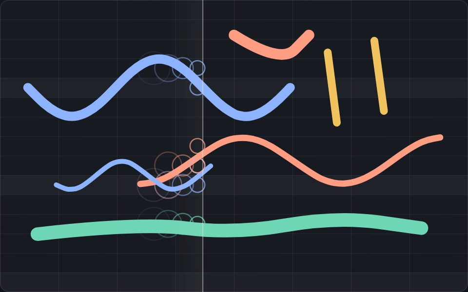

# Inkchime

**Draw lines, hear music.** Play it at **[inkchime.brightloopapps.com](https://inkchime.brightloopapps.com)**.



## Why it exists

A BrightLoop Lab project, launched on 13 Nov 2026. It was built by the Lab's night shift from my brief; I reviewed it and decided to launch it.

## How to play

Draw on the canvas with a mouse, finger or pen. A playhead sweeps left to right, looping every 4 to 8 seconds, and each line sounds as the playhead crosses it.

| You draw | You hear |
|---|---|
| **Colour** | the instrument: Bell, Pluck, Pad or Tap, each synthesized live with Web Audio (oscillators, filters, noise), no samples |
| **Height** | the pitch, snapped to a pentatonic scale over three octaves (C3 to A5), so anything you draw sounds musical |
| **Thickness** | the volume |
| **Left to right** | the time: the loop is 32 columns across, and a note starts in the column you drew it in |

A vertical scribble is a chord: a column plays at most three notes (the lowest, middle and highest the line touches). **Share** copies a link that holds the whole song (strokes, colours, sizes and tempo) in the URL hash. From then on the address bar follows the song as you keep drawing, undoing, clearing or changing the tempo, so a reload always opens what is on screen. Someone who opens a song link sees "Someone sent you a song. Press play to hear it." (browsers can't autoplay) until they press Play, draw, or open another song. Songs are never stored on a server. Inkchime counts page views, songs started and songs shared, and whether the page opened from a song link, through the lab's shared analytics script, with no cookies. What you draw, the song and its link are never sent. The [privacy note](https://lab.brightloopapps.com/privacy) lists what's counted.

The heart at the end of the dock likes Inkchime, with the live count from the lab's anonymous like counter (`lab.brightloopapps.com/api/likes`). Pressing it again takes the like back, on any later day too: the only thing this browser keeps is that like's random receipt, in `localStorage`. No cookies, and nothing about you is sent. The heart stays hidden until the count loads, and shows nothing if the counter is down or slow; drawing and sound never wait for it, and it never touches the address bar.

Keys: **Space** plays and pauses (on a focused button it presses that button instead), **Ctrl or ⌘ Z** undoes. The canvas and every control are reachable with Tab.

You can also draw with the keyboard alone. **Tab** to the canvas (the first stop on the page) and a cursor appears on the grid of 32 columns by 15 rows. The **arrow keys** move it, stopping at the edges, and **Enter** or **N** places a short note in that cell with the current colour and brush size. A placed note is an ordinary stroke: Undo, Share and the address bar treat it like a line you drew, and opening a song link and placing a note ends the invite just like drawing. Screen readers hear the canvas described with these keys, and a polite announcement says where the cursor is ("Column 5, pitch E4") and what was placed ("Bell, column 5, pitch E4"). Pick the colour and brush with Tab and the arrow keys as usual. Clicking or touching the canvas hides the cursor until the next key.

## How it works

| Part | What it does |
|---|---|
| `src/core/` | Pure TypeScript with no browser APIs, all unit-tested: `pitch.ts` (height to scale degree, thickness to gain), `stroke.ts` (quantise and simplify a stroke), `notes.ts` (strokes to notes), `share.ts` (the link format), `livelink.ts` (keeping the address bar in step after Share), `invite.ts` (when a song link invites Play), `likes.ts` (the like heart: loading the count, liking at once and rolling back what the counter refuses), `keypen.ts` (the keyboard cursor and the note it places), `scheduler.ts` (the lookahead logic), `history.ts` (undo). |
| `src/audio/` | `voices.ts` (the four instruments), `engine.ts` (the AudioContext, resumed on the first gesture), `player.ts` (a 25 ms timer that schedules the next 120 ms of notes at exact audio-clock times, so timer jitter never reaches the sound). |
| `src/ui/stage.ts` | Plain Canvas 2D in three layers: committed strokes (redrawn only when the song changes), the stroke being drawn (one small curve added per pointer event), and the rings that bloom as notes sound. The playhead is an element moved with a transform. |
| `src/analytics*.ts` | The usage events: `$pageview`, `play_started` on the first line or placed note and `play_finished` when Share hands out a link, once each per page load, with only `from` (`blank` or `link`). The lab's shared script comes from `lab.brightloopapps.com` once the page is idle, and isn't fetched at all on localhost, on `*.workers.dev` or with Do Not Track or Global Privacy Control on. It sends addresses without their `#`, where a song link keeps the drawing. |
| `index.html`, `src/style.css` | One page, light and dark from the system. On a phone held sideways (a window under 500px tall and wider than it is tall) the dock moves into a column beside the canvas, so nothing scrolls, and toasts centre over the canvas instead of the window. The voice colours are defined once in CSS and the canvas reads them back. |

The built page is about 11 KB of JavaScript gzipped, no dependencies at runtime, no web fonts.

### The share format

A song lives entirely in the link: `#v1.` and then URL-safe base64 of the tempo and every stroke. Nothing is stored on a server. The full format, its limits and how the address bar follows the song are in [`docs/share-format.md`](docs/share-format.md).

## Run it

```sh
# needs Node 22.18 or newer (the unit tests run TypeScript directly)
npm install
npm run dev                         # local dev server
npm test                            # unit tests (node --test)
npm run build                       # typecheck, then build to dist/
npm run deploy                      # build and deploy to Cloudflare
```

The playtest drives a real browser. Headless audio can't be heard, so the page exposes a small read-only hook, `window.__inkchime`, listing every note handed to Web Audio with its exact start time and the schedule the strokes should produce.

```sh
npx vite preview --port 4173 --strictPort &
node tests/playtest.ts http://localhost:4173
# PLAYTEST_BROWSER  Chromium-based browser executable (default: Brave; falls back to Playwright's Chromium)
# PLAYTEST_OUT      screenshot folder (default: ./playtest-out)
# LAB_ANALYTICS_JS  the hub's built shared analytics script (default: ~/brightloop-lab/lab/hub/public/analytics/v1.js;
#                   build it in the lab's hub with npm run bundle). The live one is never loaded.
```

The full list of what it checks is in [`docs/playtest.md`](docs/playtest.md).

## Status

Live at [inkchime.brightloopapps.com](https://inkchime.brightloopapps.com) since 13 Nov 2026. MIT licence. See [`LICENSE`](LICENSE).

Made by [Erik Pahor](https://github.com/MuteMuty) at [BrightLoop Lab](https://lab.brightloopapps.com).
